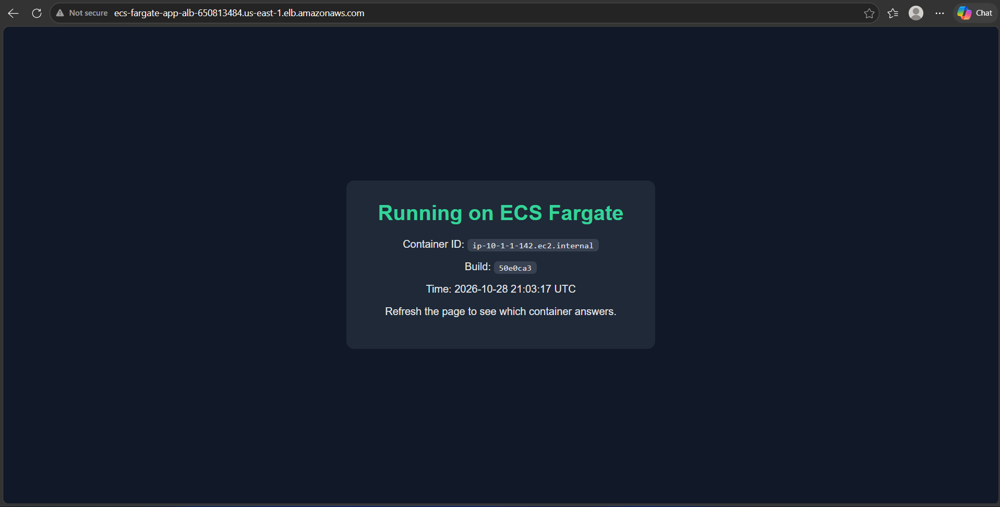
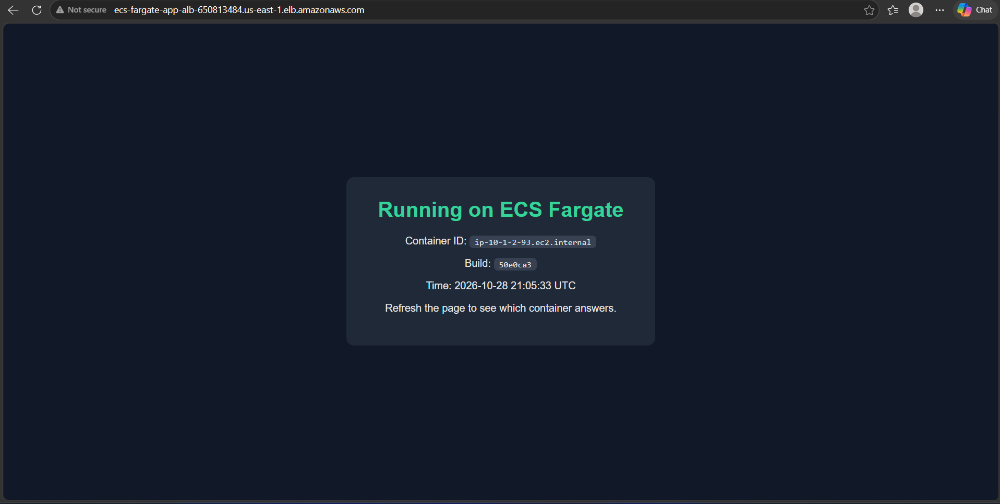
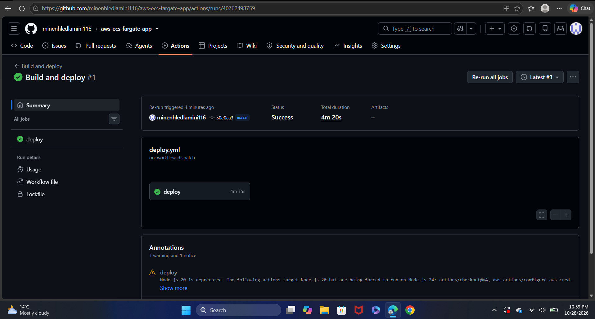
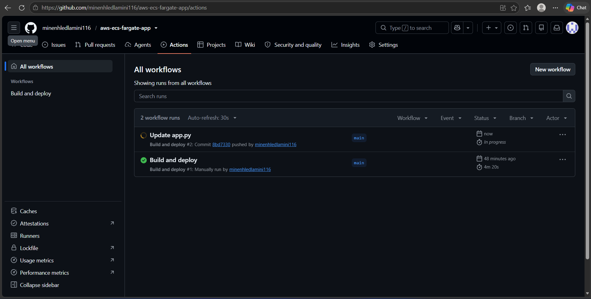
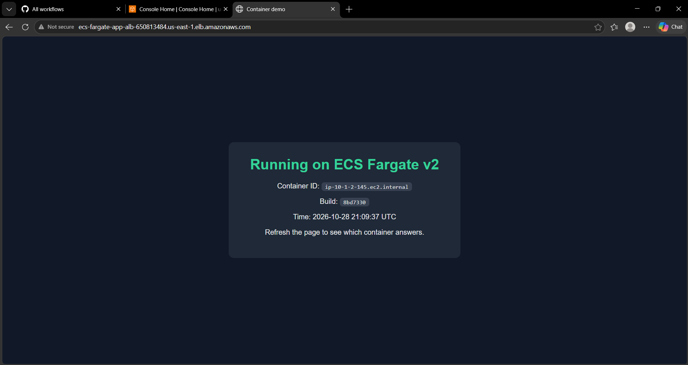
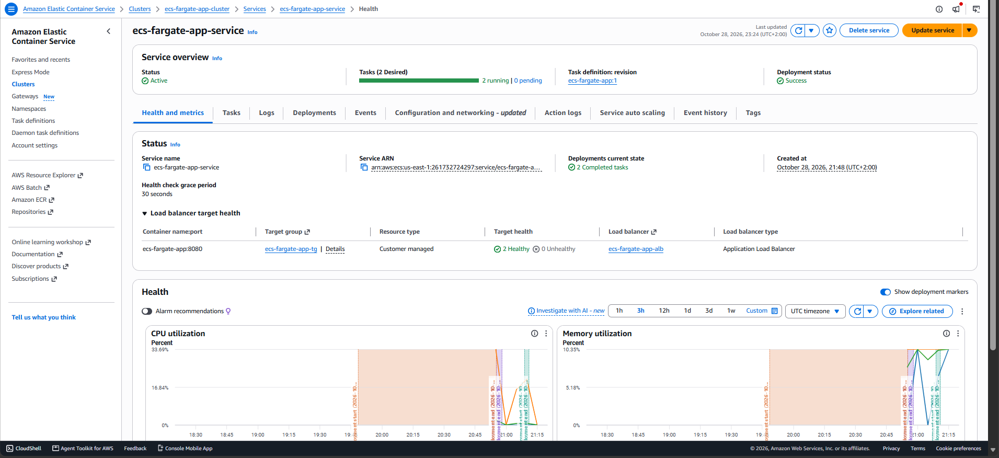
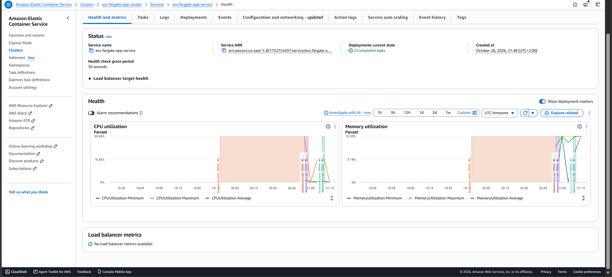
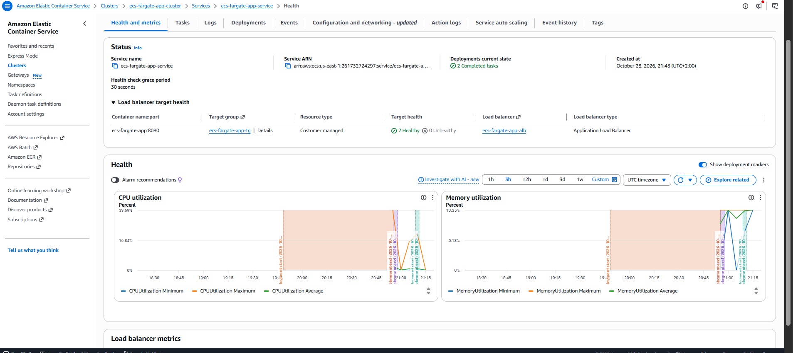
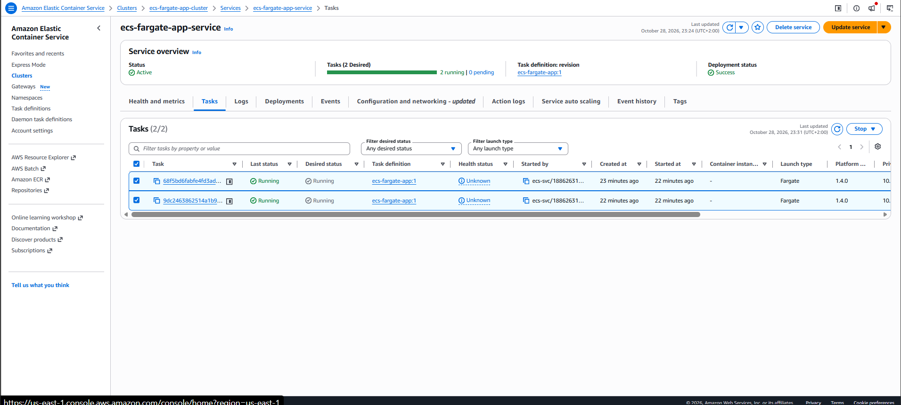
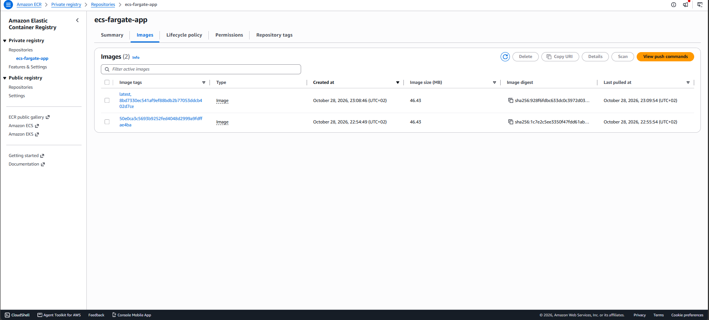

# Containerised App on AWS ECS Fargate

A small Flask app packaged in Docker and run on AWS ECS Fargate behind a load balancer. Terraform builds the infrastructure and GitHub Actions deploys new versions on every push.

## How it fits together

```
 git push --> GitHub Actions --> build image --> Amazon ECR
                                                    |
 Internet --> Load balancer --> 2 Fargate containers (pull image)
```

| Piece | What it does |
|---|---|
| Flask app | Shows the container ID and build number so you can see load balancing |
| Dockerfile | Packages the app into an image |
| Amazon ECR | Stores the Docker images |
| ECS Fargate | Runs the containers without managing servers |
| Application Load Balancer | Shares traffic between the containers and checks `/health` |
| Terraform | Creates the VPC, load balancer, ECR, ECS and IAM roles |
| GitHub Actions | Builds, pushes and redeploys on every push to `app/` |
| OIDC role | Lets GitHub deploy to AWS with no stored access keys |

## Deploy it

1. Open AWS CloudShell in `us-east-1` and install Terraform.
2. Clone the repo and go into the `terraform` folder.
3. Run `terraform init` and `terraform apply`.
4. In the GitHub repo go to Settings, Secrets and variables, Actions, Variables. Add `AWS_ROLE_ARN` with the `github_actions_role_arn` output.
5. In the Actions tab run the **Build and deploy** workflow once.
6. Open the `app_url` output in a browser and refresh to watch the container ID change.

After that, every push to `app/` rebuilds and redeploys the app.

## Clean up

```bash
cd terraform
terraform destroy
```

Then delete the `AWS_ROLE_ARN` variable in GitHub.

## Cost

The load balancer and two small Fargate containers cost a few cents per hour. Destroy everything when you are done. The containers use public subnets so the project needs no NAT gateway, which would add a much bigger bill.

## Ideas for next steps

- Tag images by commit and update the task definition instead of using `latest`
- Add HTTPS with a certificate and a custom domain
- Add autoscaling based on CPU
- Add CloudWatch alarms for failed health checks

- ## Screenshots

### The app



### The pipeline




### Inside AWS





### Clean up


